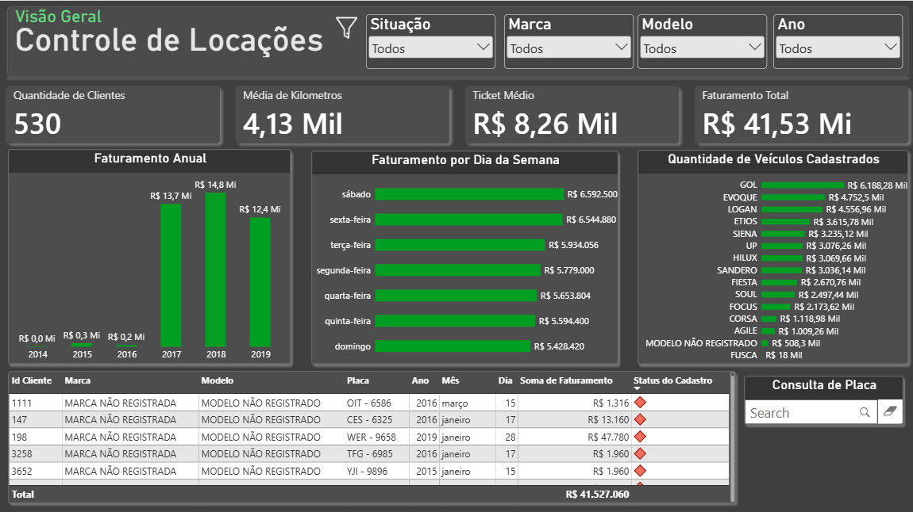
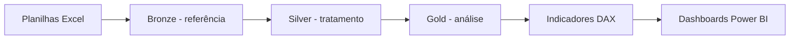
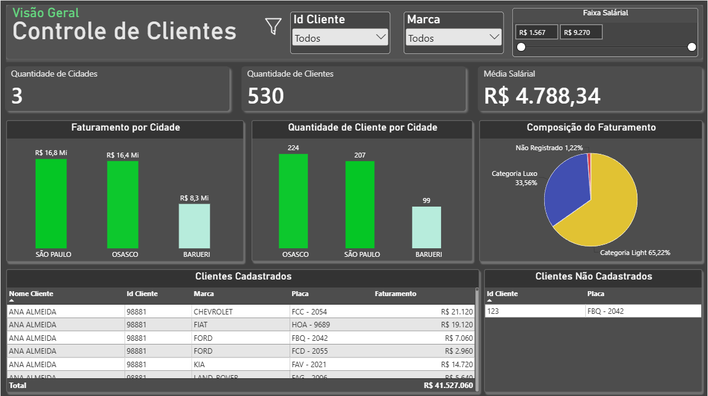
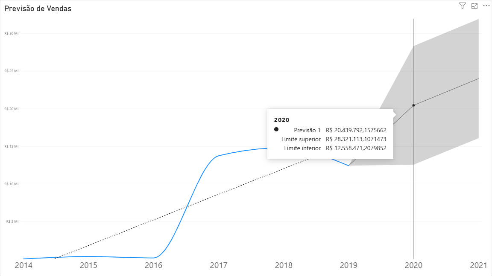
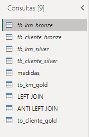

# 🚘 Análise de Locadora de Veículos | Power BI

**Projeto de portfólio • Business Intelligence • Power Query • DAX • Qualidade de dados**

Este projeto explora os dados **fictícios** de uma locadora de veículos, desde a preparação das planilhas até a criação de indicadores de negócio e dashboards interativos no Power BI. O foco do aprendizado foi compreender **como tratar, relacionar e validar os dados antes de visualizá-los**.

> **Estado do repositório:** inclui as duas bases Excel, capturas dos dashboards e documentação. O arquivo editável `.pbix` ainda **não foi fornecido** e deve ser adicionado à pasta `powerbi/` para disponibilizar a solução completa.

## 📊 Visão geral



### Indicadores demonstrados no relatório

| Indicador | Valor exibido |
| --- | ---: |
| Faturamento analisado | **R$ 41,53 milhões** |
| Clientes | **530** |
| Cidades analisadas | **3** |
| Ticket médio apresentado | **R$ 8,26 mil** |
| Média de quilômetros apresentada | **4,13 mil** |

*Os valores acima são resultados do exercício com dados fictícios, não resultados financeiros de uma empresa real. Alguns indicadores dependem dos filtros aplicados no relatório.*

## 🧩 O que foi trabalhado

**Preparação e organização:** consultas do Power Query organizadas de forma **inspirada nos princípios da arquitetura Medalhão**:

- 🥉 **Bronze:** referência aos dados de origem;
- 🥈 **Silver:** etapa de tratamento e padronização;
- 🥇 **Gold:** consultas organizadas para a camada de consumo analítico.

Essa abordagem foi aplicada **dentro do Power Query**. A nomenclatura Bronze/Silver/Gold não significa, por si só, que foi implementado um data lake/lakehouse com camadas persistidas.

**Junções e conferência cadastral:** estudo dos tipos de JOIN no Power Query, com foco em `LEFT JOIN` e `LEFT ANTI JOIN` para analisar correspondências e ausência de cadastro.

**Medidas e análise:** prática com funções DAX `CALCULATE`, `COUNT`, `COUNTA`, `DISTINCTCOUNT`, `SUM` e `AVERAGE` e revisão da diferença entre **contagem de linhas e contagem de clientes únicos**.

**Visualização:** indicadores de clientes e locações, faturamento anual, distribuição por cidade, categorias e previsão com intervalo de confiança.

### Organização lógica da análise



*O diagrama representa a estrutura conceitual reportada no projeto; o detalhamento exato dos passos de transformação exige conferir o arquivo PBIX.*

## 🖥️ Telas do relatório

### Controle de clientes



O dashboard apresenta 530 clientes: **Osasco (224)**, **São Paulo (207)** e **Barueri (99)**. As três contagens somam o total do cartão principal. As visões também permitem comparar a distribuição de clientes com o faturamento por cidade.

### Previsão de vendas



A visualização inclui a projeção e seus limites de incerteza. **Uma previsão não deve ser interpretada como receita garantida.**

### Consultas Power Query



A captura mostra consultas como `tb_km_bronze`, `tb_cliente_bronze`, `tb_km_silver`, `tb_cliente_silver`, `tb_km_gold`, `tb_cliente_gold`, `LEFT JOIN`, `ANTI LEFT JOIN` e `medidas`.

## 🛠️ Tecnologias e conceitos

`Power BI Desktop` · `Power Query` · `DAX` · `Excel` · `JOINs` · `Tratamento de Dados` · `Qualidade de Dados` · `Modelagem para BI`

## 📁 Estrutura do repositório

```text
locadora-veiculos-powerbi/
├── README.md
├── dados/
│   ├── CLIENTES.xlsx
│   ├── LOCACOES_VEICULOS.xlsx
│   └── README.md
├── imagens/
│   ├── 01-controle-locacoes.png
│   ├── 02-controle-clientes.png
│   ├── 03-previsao-vendas.png
│   └── 04-consultas-medalhao.png
├── docs/
│   ├── DICIONARIO_DADOS.md
│   ├── PROCESSAMENTO_E_JOINS.md
│   ├── INDICADORES_E_VALIDACAO.md
│   └── PUBLICACAO_GITHUB.md
└── powerbi/
    └── README.md
```

## ▶️ Como explorar o projeto

1. Consulte as imagens e o resumo técnico deste README.
2. Abra as planilhas da pasta `dados/` para conhecer os dados fictícios de origem.
3. Quando o arquivo `.pbix` for adicionado à pasta `powerbi/`, abra-o no **Power BI Desktop** e, se necessário, atualize os caminhos de origem das planilhas no Power Query.
4. Revise as medidas, os relacionamentos e o resultado das transformações no arquivo editável.

## 🧠 Aprendizados

A construção de gráficos é apenas uma das etapas de um projeto de BI. É necessário entender a origem dos dados, investigar registros sem correspondência e verificar se as medidas estão contando **linhas, entidades únicas ou valores monetários** conforme a pergunta de negócio.

## ℹ️ Transparência

- **Dados fictícios:** os registros e valores são destinados a estudo e demonstração.
- **Sem arquivo PBIX neste pacote:** os códigos M, medidas DAX e relações do modelo não foram exportados; nenhum desses elementos foi reconstruído artificialmente.
- **Imagens:** as capturas representam versões compartilhadas do relatório; a tela de clientes é a revisão mais recente enviada.
- **Licença:** nenhuma licença de reutilização foi concedida automaticamente aos dados ou ao projeto.
